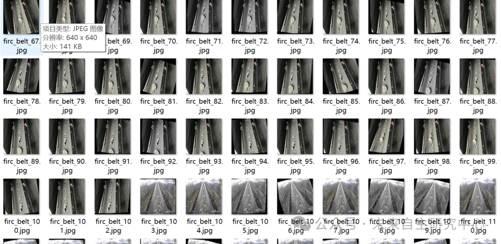
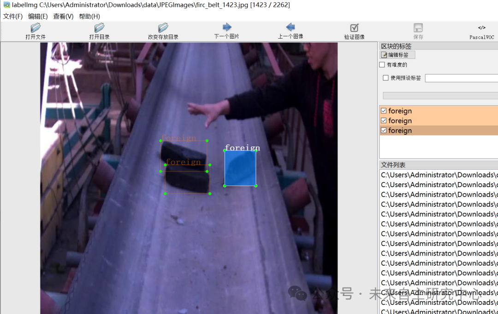

# Mine Industrial Transport Belt Detection Data Set for Stone Defects - VOC+YOLO format with 2262 images in 4 categories

The overall quality of the dataset is low, with enhanced images. It indeed requires downloadable versions. For specifics, please refer to the video introduction.

https://www.bilibili.com/video/BV1PqCtYeEE4/?vd_source=989ae2b903ea1b5acebbe2c4c4a635ee

Dataset format: Pascal VOC format + YOLO format (txt file without split path, only containing jpg images and corresponding VOC format xml files and yolo format txt files)

Number of images (number of jpg files): 2262

Number of annotations (number of xml files): 2262

Number of annotations (number of txt files): 2262

Labeling category count: 4

Annotation category names: ["block", "crack", "foreign", "hole"]

Number of boxes labeled in each category:

Block count = 10643

Crack Frames = 448

Foreign Frame Count = 2455

Number of holes = 413

Total frame count: 13959

Using labelImg:

Annotation rules: Draw a rectangle around the category.

Important Notice: No

Special : This dataset does not guarantee the accuracy or precision of the trained models or weight files. The dataset is provided with accurate and reasonable annotations only.

Image Preview:

Annotation example:

## Payment

Here is a pay link on Stripe ( https://buy.stripe.com/3cs8yP7sY87d0vu9AB ). Please contact me lonlonago@foxmail.com after funding $89, and I will send you a complete data files , thank you!

